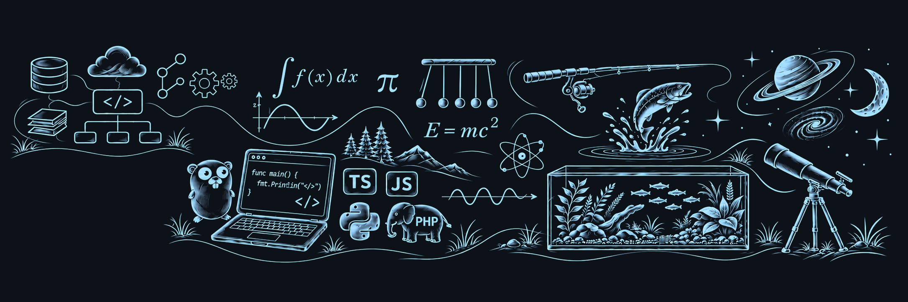

  

  <strong>Backend Engineer · Software Architecture · Technical Leadership</strong> 
  Building reliable services. Connecting systems. Turning product needs into software.

  <a href="https://www.linkedin.com/in/eudanielvieira/"><strong>LinkedIn ↗</strong></a>
  &nbsp; · &nbsp;
  <a href="mailto:daniel.vieira@dimx.one"><strong>Email ↗</strong></a>
  &nbsp; · &nbsp;
  <a href="./README.pt-BR.md"><strong>Leia em português</strong></a>

---

### About me

Brazilian software engineer with **13+ years of experience** across healthcare, retail, and digital services. I combine hands-on backend development with architectural decisions and technical guidance.

My work centers on **APIs, integrations, distributed systems, and software that is easier to operate and evolve**. I also serve as Founder & CTO at **DIMX**, connecting product needs with engineering decisions.

### Where I contribute

| Design & build | Connect & evolve | Guide & deliver |
| :--- | :--- | :--- |
| Backend services and APIs | System integrations | Technical direction |
| Microservices and BFFs | Asynchronous messaging | Architecture decisions |
| Data persistence | Reliability and observability | Engineering guidance |

### Technical toolkit

**Backend**  
`Node.js` `TypeScript` `NestJS` `PHP` `Laravel`

**Data & messaging**  
`PostgreSQL` `MySQL` `MongoDB` `RabbitMQ`

**Architecture & delivery**  
`REST` `GraphQL` `Microservices` `Docker` `CI/CD` `Observability`

### Experience at a glance

- **Dasa** — Technical leadership for backend engineering, patient journey services, core services, and healthcare integrations.
- **Cobasi** — Checkout microservices, VTEX APIs, RabbitMQ messaging, and MongoDB persistence.
- **Rede Melhor Compra & Portal do PBM** — Long-term development and evolution of digital platforms and pharmaceutical industry integrations.
- **DIMX** — Founder & CTO, bringing strategy, product, and engineering together.

### Beyond day-to-day engineering

**Go / Golang** is a personal learning interest. I explore its approach to concurrency, simplicity, and backend service development.

I am also developing my English communication skills.

---

  <strong>Let’s talk about backend, architecture, and digital products.</strong>  
  <a href="mailto:daniel.vieira@dimx.one">daniel.vieira@dimx.one</a>
  &nbsp; · &nbsp;
  <a href="https://www.linkedin.com/in/eudanielvieira/">linkedin.com/in/eudanielvieira</a>

