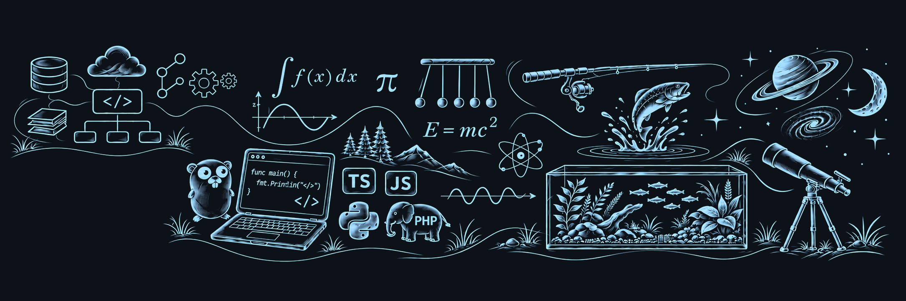

  

  <strong>Engenharia Backend · Arquitetura de Software · Liderança Técnica</strong> 
  Serviços confiáveis. Sistemas conectados. Necessidades de produto transformadas em software.

  <a href="https://www.linkedin.com/in/eudanielvieira/"><strong>LinkedIn ↗</strong></a>
  &nbsp; · &nbsp;
  <a href="mailto:daniel.vieira@dimx.one"><strong>E-mail ↗</strong></a>
  &nbsp; · &nbsp;
  <a href="./README.md"><strong>Read in English</strong></a>

---

### Sobre mim

Engenheiro de software brasileiro com **mais de 13 anos de experiência** em saúde, varejo e serviços digitais. Combino desenvolvimento backend próximo do código com decisões de arquitetura e orientação técnica.

Minha atuação se concentra em **APIs, integrações, sistemas distribuídos e software mais fácil de operar e evoluir**. Também sou Founder & CTO da **DIMX**, conectando necessidades de produto às decisões de engenharia.

### Como contribuo

- **Projetar e construir** — Serviços backend, APIs, microsserviços, BFFs e persistência de dados.
- **Conectar e evoluir** — Integração entre sistemas, mensageria assíncrona, confiabilidade e observabilidade.
- **Orientar e entregar** — Direção técnica, decisões de arquitetura e orientação de engenheiros.

### Ferramentas e tecnologias

**Linguagens**  
`Go` `TypeScript` `JavaScript` `PHP`

**Backend e frameworks**  
`Node.js` `NestJS` `Laravel`

**Dados e mensageria**  
`PostgreSQL` `MySQL` `MongoDB` `RabbitMQ`

**Arquitetura e entrega**  
`REST` `GraphQL` `Microsserviços` `Docker` `CI/CD` `Observabilidade`

### Experiência em resumo

- **Dasa** — Liderança técnica de backend, serviços para a jornada do paciente, serviços core e integrações de saúde.
- **Cobasi** — Microsserviços de checkout, APIs da VTEX, mensageria com RabbitMQ e persistência com MongoDB.
- **Rede Melhor Compra e Portal do PBM** — Desenvolvimento e evolução de plataformas digitais e integrações do setor farmacêutico.
- **DIMX** — Founder & CTO, aproximando estratégia, produto e engenharia.

### Além da engenharia do dia a dia

**Go / Golang** é um interesse pessoal de estudo. Exploro sua abordagem de concorrência, simplicidade e desenvolvimento de serviços backend.

Também estou desenvolvendo minha comunicação em inglês.

---

  <strong>Vamos conversar sobre backend, arquitetura e produtos digitais.</strong>  
  <a href="mailto:daniel.vieira@dimx.one">daniel.vieira@dimx.one</a>
  &nbsp; · &nbsp;
  <a href="https://www.linkedin.com/in/eudanielvieira/">linkedin.com/in/eudanielvieira</a>

